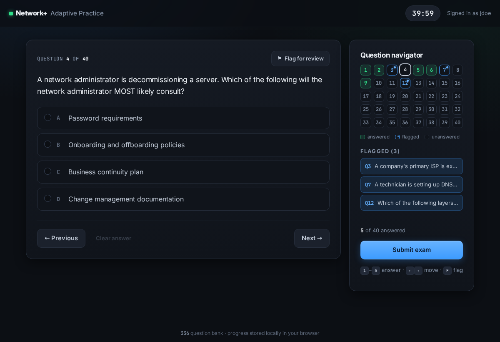

# Net+ Practice Exam Generator

A static, adaptive practice-exam generator for CompTIA Network+, hosted on GitHub Pages.
**660 questions** in the bank; each exam is **40 questions in 40 minutes**, and the
questions a student misses are weighted to come back.

**Take the exam:** https://unicron47.github.io/net-plus-practice-exam-generator/

No server, no database, no accounts, no build step — just HTML, CSS and one JS file.



---

## For students

1. Open the site, type your name or student ID, press **Start exam**.
2. One question at a time. **Previous / Next** to move, or click any number in the
   navigator grid to jump straight there.
3. **Flag for review** marks a question; flagged questions appear in a list in the
   sidebar and clicking one jumps to it.
4. Change any answer as many times as you like until you submit or the clock runs out.
5. At 0:00 the exam submits itself and is scored.

Keyboard: <kbd>1</kbd>–<kbd>5</kbd> pick an answer, <kbd>←</kbd>/<kbd>→</kbd> move,
<kbd>F</kbd> flag.

**Your progress lives in your browser, not in the cloud.** Use the same browser on the
same computer each time. If you need to switch machines, use *Export progress* and then
*Import progress* on the other one. Refreshing or accidentally closing the tab mid-exam
is safe — your answers, flags and the remaining time are all restored. (The clock keeps
running while the tab is closed, so this can't be used to buy extra time.)

---

## How the adaptive weighting works

Every question carries a weight. Exams are drawn by weighted random sampling without
replacement, so no question repeats inside a single exam.

```
weight = MISS_WEIGHT[times missed] × STREAK_DECAY ^ (correct answers in a row)
```

| Question state                  | Weight | Meaning                                  |
|---------------------------------|-------:|------------------------------------------|
| Never seen                      |   1.00 | the baseline                             |
| Missed once                     |   8.00 | 8× more likely than an unseen question   |
| Missed twice                    |  20.00 | escalates again                          |
| Missed three times              |  35.00 |                                          |
| Missed four or more times       |  50.00 | caps here                                |
| Missed once, then right once    |   3.20 | fading, but still favoured               |
| Missed once, then right twice   |   1.28 | nearly back to baseline                  |
| Never missed, right once        |   0.40 | starts dropping out of rotation          |
| Never missed, right three times |   0.06 | effectively retired                      |

On top of that there is a **hard guarantee**: up to **60%** of each exam (24 of 40 slots)
is reserved for questions the student has missed and not yet re-learned. The remaining
slots are weighted-random across the whole bank, so new material keeps appearing instead
of the student drilling the same 24 questions forever.

A question stops claiming a reserved slot once it has been answered correctly **twice in
a row** — that is what "mastered" means on the progress card.

### What that looks like in practice

`npm run simulate` runs the real selection code against a simulated student who reliably
knows 70% of the bank:

```
attempt | drawn from miss-list | new(unseen) | score
   1    |         0 (  0%)     |     40      |  27/40     ← first exam is pure random
   2    |        13 ( 33%)     |     27      |  18/40
   3    |        24 ( 60%)     |     14      |  21/40     ← reaches the 60% reserve
   4    |        25 ( 63%)     |     15      |  22/40
   6    |        26 ( 65%)     |     12      |  12/40
   8    |        27 ( 68%)     |     12      |  15/40
```

Slightly above 60% is expected: the reserved slots are filled first, and missed
questions can also win some of the remaining weighted-random slots.

Scores *drop* over the first few attempts. That is the algorithm working: the student is
being fed the material they don't know. It recovers as they actually learn it.

### Tuning it

All of it is at the top of [`js/app.js`](js/app.js) in the `CONFIG` object:

```js
EXAM_SIZE: 40,                  // questions per exam
EXAM_MINUTES: 40,               // countdown length
MISS_WEIGHT: [1, 8, 20, 35, 50],// weight by number of times missed
STREAK_DECAY: 0.4,              // ×0.4 per consecutive correct answer
MISSED_TARGET_RATIO: 0.6,       // share of the exam reserved for missed questions
MASTERY_STREAK: 2,              // correct-in-a-row before a question counts learned
```

Raise `MISSED_TARGET_RATIO` toward `0.9` for a pure remediation drill; drop it toward
`0.2` if you want students to keep covering fresh ground. Run `npm run simulate` after
changing anything to see the effect.

---

## Running it locally

`fetch()` is blocked on `file://` URLs, so open it through a web server rather than
double-clicking `index.html`:

```bash
npm run serve      # then visit http://localhost:8000
```

---

## Updating the question bank

The site reads [`data/questions.json`](data/questions.json), generated from one master
spreadsheet, *Net ExamTopics Master*:

```bash
python3 tools/build_questions.py "/path/to/Net ExamTopics Master.xlsx"
```

To avoid retyping the path, put it in `tools/sources.local.txt` (gitignored) and run the
script with no arguments.

Spreadsheet columns (row 1 is the header):

| Column | Contents |
|--------|----------|
| A | Question text |
| B | `Multiple Choice` or `Checkbox` |
| C–G | Option 1 … Option 5 (blank options are ignored) |
| H | Correct answer as an option number: `3`, or `1,4` for multi-answer |
| I | Time in seconds (unused; the exam is timed as a whole) |
| J | Image link (unused) |
| K | Answer explanation, shown on the review screen after an exam |
| L | Exhibit: a table or command output, shown in a monospace box after the question's "…the following:" line |
| M–O | Review status, proposed explanation, proposed exhibit: working notes, **never published** |

To approve a proposal, copy column N into K (or O into L), clear M and rebuild.

The converter uses **only the Python standard library**, so no pip installs are needed. It
skips malformed rows and duplicates and prints what it skipped. Question IDs are a hash
of the question text, so **student progress survives rows being reordered, inserted or
deleted**, as long as the wording doesn't change. Editing a
question's text makes it a new question with fresh statistics.

### Explanations and exhibits

`tools/explain/` generated the explanations with the Claude API. For each question, the
model answered **without seeing the answer key**. The explanation was only accepted when
its answer matched the key, it was confident, and it passed checks for length (at most
60 words), naming the correct answer, and not referring to options by letter (options
are shuffled for students). Disagreements went to a second, more careful model call
that saw the key. Some exhibits were lost when the questions were exported to Excel.
Replacements were generated, then accepted only if a separate blind check picked the
keyed answer. Everything else is left in columns M–O for the instructor.
---

## Design

Dark by default and dark only — graphite surfaces (`#0c0f14` → `#222937`) with two very
faint colour pools in the page background so it isn't a flat slab. Colour is used as a
signal, not decoration:

| Colour | Means |
|---|---|
| Bright blue `#3d9bff` | anything actionable — primary buttons, the selected option, flagged questions, focus rings |
| Bright green `#2fe08a` | correct / answered / mastered |
| Red `#ff6b72` | missed |
| Silver `#c2cbd8` / muted `#8492a6` | body copy and labels |

Type is **Inter** for the interface and **JetBrains Mono** for anything numeric — the
timer, question counters, scores, the navigator grid. Both load from Google Fonts with
a system-font fallback, so the site still looks right on a network that blocks it.

All of it is CSS custom properties at the top of [`css/styles.css`](css/styles.css);
change `--blue`, `--green` and the `--bg`/`--panel` ramp and the whole site follows.
The layout is responsive down to phone width (the navigator moves below the question),
and honours `prefers-reduced-motion`.

---

## Tests

```bash
npm install     # jsdom, only needed for the tests
npm test
```

70 assertions across two files driving the real DOM: answering, navigation, flagging and
the flag list, the navigator, persistence, reload-mid-exam, clock expiry and auto-submit,
grading (including multi-answer set matching), the review screen, stats accumulation,
export/import, and that exam two is actually weighted toward exam one's misses.

These run in jsdom, which has no layout engine — so the screens were also driven and
screenshotted in headless Chromium at desktop and phone width. That pass caught a bug
jsdom structurally cannot see: `.modal { display: grid }` overrode the `hidden`
attribute, leaving an invisible full-screen overlay that swallowed every click. Hence
the `[hidden] { display: none !important; }` rule near the top of the stylesheet — don't
remove it.

---

## Known limits

- **Progress is per-browser.** `localStorage` is the only storage a GitHub Pages site
  can use. Shared lab machines share progress unless each student uses a different
  profile name; clearing browser data wipes it. Export/import is the escape hatch. If you
  later want real cross-device accounts or an instructor gradebook, that needs a backend
  (Google Sheets + Apps Script, Supabase, Firebase) — the storage layer in `app.js` is
  isolated behind `load`/`save` to make that swap straightforward.
- **The answer key is in the page**, as it must be for any client-side exam. This is a
  practice tool, not a proctored assessment.
- **No answer explanations.** The spreadsheet's explanation column (K) is empty. If it is
  filled in, the converter can carry explanations through to the review screen.
- **A few questions reference exhibits** (tables or diagrams) that didn't survive the
  export to Excel — e.g. spreadsheet row 5, "with the following number of clients to be
  allowed on each:". They are answerable but harder than intended. Column J exists for
  image links but is empty throughout.
